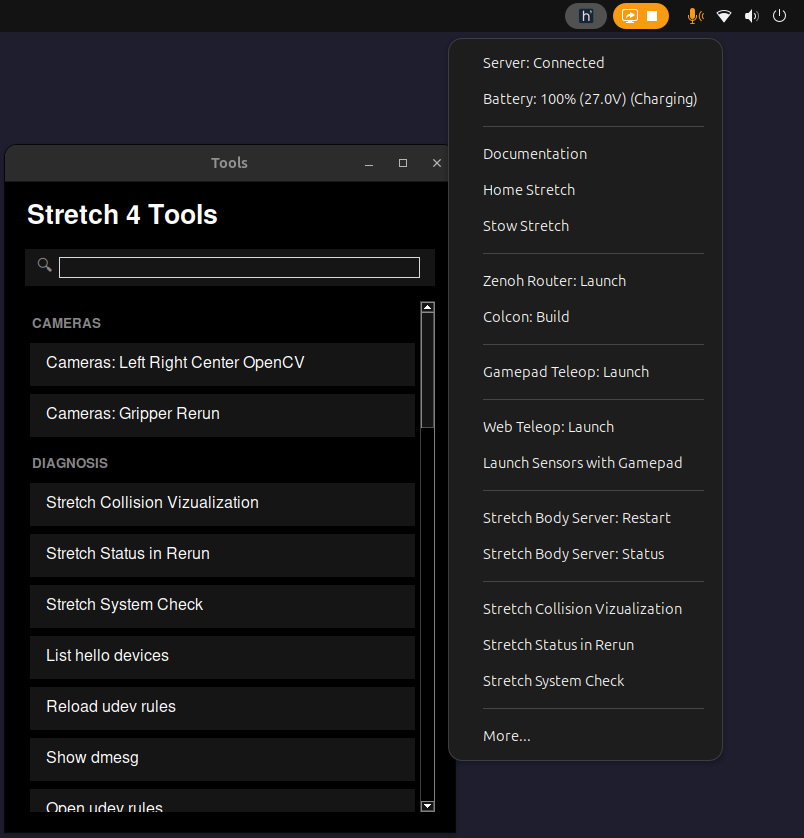

# Overview



`stretch4_tray` is an Ubuntu system tray application for displaying battery level and providing a system tray menu for launching Stretch tools or help resources. This package can be installed by:

```
python3 -m pip install -U hello-robot-stretch4-tray
stretch_tray --install # Installs the linux service to automatically start the tray
stretch_tray --restart # Immediately start the tray
```

If you do not want to use the linux service, you can just run `stretch_tray`.


### Developing

To develop on this package:

```bash
sudo apt update
sudo apt install pkg-config libcairo-dev gir1.2-appindicator3-0.1 libgirepository-2.0-dev

git clone https://github.com/hello-robot/stretch4_tray
cd stretch4_tray

uv venv --system-site-packages --no-managed-python
uv pip install -e .
```

### Managing `stretch4_tray` Service (Recommended)

The easiest way to run `stretch4_tray` is as a linux systemd user service.

To install and start the service:
```bash
stretch_tray --install
```

Other available management commands:
- `stretch_tray --status`: Check if the service is running and view recent logs
- `stretch_tray --restart`: Restart the service
- `stretch_tray --uninstall`: Stop and remove the service, and uninstall the Python package
- `stretch_tray --kill`: Forcefully stop the service and any dangling processes

To view continuous logs:
```bash
journalctl --user -u stretch_tray.service -f
```

### Configuration

On the first run, `stretch_tray` creates a user-editable configuration file at:
`$HELLO_FLEET_PATH/$HELLO_FLEET_ID/stretch_tray.yaml`

By default, this is a copy of the built-in configuration. You can modify this file to add, remove, or change the tools that appear in the tray and the GUI.

If you want to reset your configuration to the default:
```bash
stretch_tray --factory_reset
```


## Edit scripts list

To edit the scripts list that shows up in both the system tray and the GUI, please do the following:

1. Edit your user configuration file at $HELLO_FLEET_PATH/$HELLO_FLEET_ID/stretch_tray.yaml
2. Add or modify commands to match the [ScriptsConfig data model](stretch4_tray/scripts_config.py) schema. 
    - Please reference the docstrings in [ScriptsConfig](stretch4_tray/scripts_config.py) for details on each field.
3. Restart the tray: `stretch_tray --restart`

## Connecting to Wi-Fi with a QR code

`stretch_wifi_connect` joins a Wi-Fi network by scanning its QR code with the robot's center camera:

```bash
stretch_wifi_connect
```

Hold up a phone showing a standard Wi-Fi QR code (iOS: *Settings > Wi-Fi > the network > Share Password*, Android:
*Settings > Network & internet > the network > Share*). The robot chimes once the camera is live, outlines the code
when it reads it, hands the credentials to `nmcli`, and then plays a success or failure sound. Press `q` or close the
preview window to quit.

This requires the robot's camera node to be running, since the frames come from the center camera's ROS 2 topic.

To run it automatically at login, add [`stretch4_tray/scripts/run_wifi_connect.sh`](stretch4_tray/scripts/run_wifi_connect.sh)
as an Ubuntu Startup Application.
